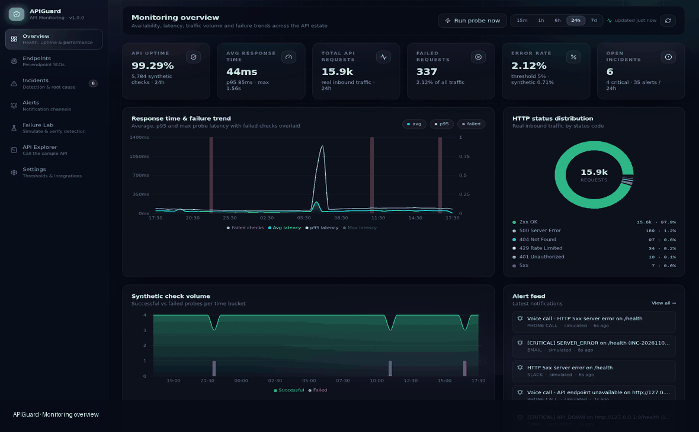

<div align="center">

# APIGuard

**API Monitoring Dashboard — FastAPI · React · SQLite · Prometheus**

Sample REST API + full monitoring stack: health tracking, performance metrics,
failure detection, multi-channel alerting (Slack / E-mail / Phone) and automatic
root cause analysis.



</div>

---

## 1. What is inside

| Layer | Technology | Location |
|---|---|---|
| Sample REST API | FastAPI 0.115 + Uvicorn | `backend/app/routers/sample.py` |
| Monitoring engine | asyncio probe loop + live-traffic detection | `backend/app/monitoring/engine.py` |
| Root cause analysis | rule-based engine, 9 categories | `backend/app/monitoring/rca.py` |
| Alerting | Slack (Block Kit) · SMTP e-mail · Twilio voice call | `backend/app/monitoring/alerter.py` |
| Metrics | Prometheus exposition (`/metrics`) | `backend/app/monitoring/metrics.py` |
| Storage | SQLite (SQLAlchemy 2.0, 7 tables) | `backend/app/models.py` |
| Dashboard | React 18 + Vite 5 + Tailwind 3 + Recharts | `frontend/src` |
| Tests | pytest (22 cases) + CLI scenario runner | `backend/tests`, `backend/scripts` |

## 2. Quick start (2 terminals)

```bash
# ── terminal 1: backend ────────────────────────────────────────────────
cd backend
python -m venv .venv && source .venv/bin/activate      # Windows: .venv\Scripts\activate
pip install -r requirements.txt
python -m uvicorn app.main:app --host 0.0.0.0 --port 8000

# ── terminal 2: frontend ───────────────────────────────────────────────
cd frontend
npm install
npm run dev
```

Or with the helper scripts (Linux/macOS: `./start.sh`, Windows: `start.bat`),
which do the install and start both servers.

| URL | Content |
|---|---|
| **http://localhost:5173** | React monitoring dashboard |
| http://localhost:8000/docs | Swagger / OpenAPI |
| http://localhost:8000/health | health endpoint |
| http://localhost:8000/metrics | Prometheus metrics |
| http://localhost:8000/monitor/summary | monitoring REST API |

The first backend start seeds **24 hours of realistic history** (≈ 5 800 probe
records, ≈ 16 000 traffic records, 5 resolved incidents with RCA) so the
dashboard is meaningful immediately. Disable with `SEED_HISTORY_ON_STARTUP=false`.

## 3. Sample API

| Endpoint | Behaviour |
|---|---|
| `GET /health` | 200 healthy · `?degraded=true` → 503 |
| `GET /users?limit=N` · `GET /users/{id}` | sample data · 404 for unknown ids |
| `GET /products?limit=N&category=` | sample catalogue |
| `GET /secure-data` | 200 with `X-API-Key` · 401 missing · 403 invalid |
| `GET /simulate-error` | raises → **HTTP 500** (traceback captured) |
| `GET /simulate-timeout?seconds=N` | sleeps N seconds (default 6 s) |
| `GET /simulate-rate-limit` | **429** after 5 requests / 60 s |
| `GET /simulate-auth-error` | always **401** |

Every response carries `X-Request-ID` and `X-Response-Time`.

## 4. Monitoring & alerting

**Signals**: availability, response time, HTTP status codes, error percentage,
failed requests, server health — from *synthetic probes* (every 10 s) **and**
*real inbound traffic*.

**Alert rules** (8):

| Rule | Trigger | Severity | Channels |
|---|---|---|---|
| `API_DOWN` | 2 consecutive failures / transport error | critical | Slack + Email + Call |
| `SERVER_ERROR` | HTTP 5xx | critical | Slack + Email + Call |
| `TIMEOUT` | request exceeds the timeout budget | critical | Slack + Email + Call |
| `HEALTH_CHECK_FAILED` | `/health` unhealthy | critical | Slack + Email + Call |
| `SLOW_RESPONSE` | latency > 3000 ms | warning | Slack + Email |
| `HIGH_ERROR_RATE` | failure rate > 5 % / 5 min | warning | Slack + Email |
| `AUTH_FAILURE` | HTTP 401 / 403 | warning | Slack + Email |
| `RATE_LIMIT` | HTTP 429 | warning | Slack + Email |

Channels without credentials run in **dry-run** mode: the payload is fully
rendered and stored (`data/alert-outbox/*.jsonl`) — that is the notification
proof shipped with the deliverables.

## 5. Failure lab (verification)

Dashboard → **Failure Lab** → *Run all scenarios*, or from the CLI:

```bash
cd backend && python scripts/simulate_failures.py
# RESULT: 7/7 scenarios detected by the monitoring stack
```

| Scenario | Detected as | Detection time |
|---|---|---|
| Invalid API authentication (401) | `AUTH_FAILURE` | 11 ms |
| API timeout (client aborts at 8 s) | `TIMEOUT` | 7 ms |
| Server error (500) | `SERVER_ERROR` + captured traceback | 7 ms |
| Rate limit exceeded (429) | `RATE_LIMIT` | 6 ms |
| Latency SLO breach (3.5 s) | `SLOW_RESPONSE` | 9 ms |
| Health-check failure (503) | `HEALTH_CHECK_FAILED` | 6 ms |
| API downtime (connection refused) | `API_DOWN` | 13 ms |

Every incident carries its root cause, probable causes, captured evidence
(status, latency, exception, stack trace, request id) and ranked remediation
steps — see `docs/08-failure-simulation-results.md`.

## 6. Repository layout

```
api-monitoring/
├── backend/                 FastAPI service, monitoring engine, tests
│   ├── app/                 core · monitoring · routers · models · schemas
│   ├── scripts/             simulate_failures.py (CLI evidence runner)
│   ├── tests/               pytest suite (22 cases)
│   ├── data/                SQLite DB + alert outbox (runtime)
│   ├── requirements.txt  └── .env.example
├── frontend/                React dashboard
│   ├── src/  components · pages · lib
│   ├── vite.config.js  └── package.json
├── docs/                    11 documents + Grafana dashboard + Prometheus config
├── deliverables/            screenshots, demo GIF, test results, alert proof
├── tools/capture_demo.py    Playwright capture (screenshots + GIF)
├── start.sh / start.bat     one-command startup
└── README.md
```

## 7. Documentation index

| # | Document |
|---|---|
| 01 | `docs/01-product-requirements.md` — PRD: goals, personas, functional & non-functional requirements, definition of done |
| 02 | `docs/02-design-requirements.md` — DRD: architecture, data flow, module map, design decisions |
| 03 | `docs/03-database-schema.md` — full schema, indexes, retention, PostgreSQL migration, sample SQL |
| 04 | `docs/04-backend-guide.md` — FastAPI setup, configuration, API reference, extension points |
| 05 | `docs/05-frontend-guide.md` — React setup, views, design system, troubleshooting |
| 06 | `docs/06-monitoring-architecture.md` — detection layers, dashboard configuration, Prometheus + Grafana |
| 07 | `docs/07-alerting-guide.md` — alert rules, channels, payloads, testing, tuning |
| 08 | `docs/08-failure-simulation-results.md` — test results + RCA for every scenario |
| 09 | `docs/09-troubleshooting-guide.md` — runbook for API, engine, dashboard, alerting, DB |
| 10 | `docs/10-maintenance-process.md` — daily/weekly/monthly routines, backup, releases |
| + | `docs/grafana-dashboard.json`, `docs/prometheus.yml` |

## 8. Deliverables

| Deliverable | Location |
|---|---|
| FastAPI source code | `backend/` |
| React dashboard source | `frontend/` |
| Dashboard screenshots | `deliverables/screenshots/*.png` (8 views) |
| Demo GIF (animated walkthrough) | `deliverables/demo.gif` |
| Alert notification proof | `backend/data/alert-outbox/alerts-*.jsonl`, `alerts.log`, `deliverables/alert-proof.md` |
| Failure testing results | `backend/data/failure-test-results.{json,csv}`, `deliverables/` |
| Automated test report | `deliverables/test-report.txt` |
| Technical documentation | `docs/` (10 documents) |
| PRD / DRD / DB schema | `docs/01-…`, `docs/02-…`, `docs/03-…` |

## 9. Verified state

- ✅ FastAPI sample API running on `:8000` (Swagger at `/docs`)
- ✅ Monitoring configured — 4 endpoints probed every 10 s + live traffic capture
- ✅ Dashboard running on `:5173` with 7 views and 9 charts
- ✅ 8 alert rules, 3 notification channels, test endpoint, dry-run proof
- ✅ 7/7 failure scenarios detected (6–13 ms) with RCA on every incident
- ✅ 22/22 automated tests passing
- ✅ Database: 8 endpoints · 5 844 probe records · 15 978 request logs · 14 incidents (all with RCA) · 35 alerts

---

Built as a reference implementation of an API monitoring platform.
Licensed for demonstration and internal use.
